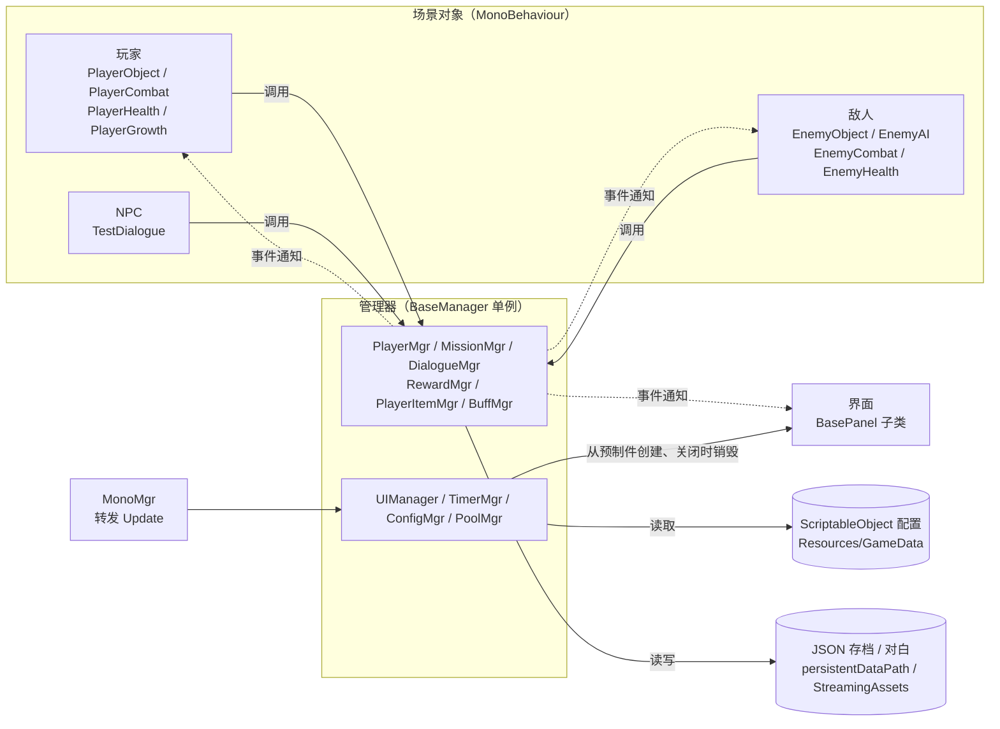
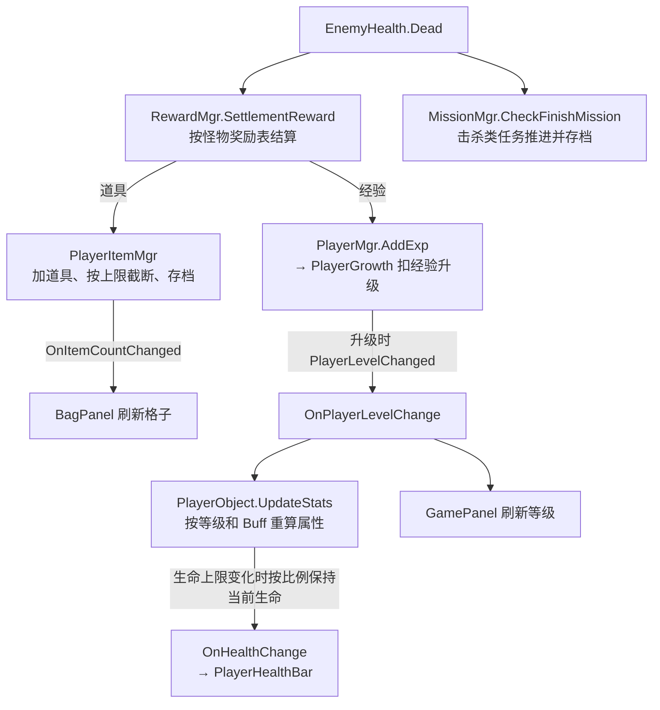

# 星渊回响 · AstralEchoes

一款二次元风格的第三人称动作角色扮演游戏（ARPG）原型，用 Unity 6 / C# 个人开发，目前仍在开发中。它也是作者的本科毕业设计《基于Unity3D的ARPG游戏〈星渊回响〉设计与实现》的工程。

> 游戏玩法代码由作者本人设计和编写；Codex 与 Claude Code 用于代码审查、调试控制台与编辑器工具、部分美术资源处理、文档和仓库管理，分工见[开发方式与 AI 辅助](#开发方式与-ai-辅助)。

游戏只有一个"剧情探索模式"，部分战斗节点会加入"三选一临时 Buff"事件，不做独立的 Roguelite 模式。当前目标是先打通最小可演示闭环：进入场景 → 对话接任务 → 战斗 → 交付任务 → 保存进度。

## 演示

演示视频整理中。

## 现在能玩到什么

以下内容都在测试场景 GMScene 中，均有用户实测或 Play Mode 自动检查的记录（详见[功能状态](#功能状态)）：

1. 镜头相对的第三人称移动和冲刺，冲刺结束后转入奔跑；普攻敌人，敌人会巡逻、追击、攻击和脱战返回。
2. 找 NPC 对话接任务 → 击杀指定怪物 → 回去交付 → 奖励进入背包，交付后再对话不会重复发奖。
3. 击杀怪物获得经验并升级，属性按等级重新计算，HUD 跟着刷新（11-24 属性改为 float 后，实机回归待做，#33）。
4. 打开背包查看持有道具和详情，道具数量有上限。
5. 临时 Buff 按百分比加成攻击、防御或生命上限，时间到了自动移除；打开背包暂停时计时也会暂停。目前 Buff 只能从调试控制台添加，三选一面板还没做。
6. 任务进度、等级经验和持有道具都写入 JSON 存档；任务进度和等级经验重进游戏后保留已实测。

还没有的内容：技能、闪避无敌判定、首领、场景切换与剧情推进、音效、开始界面、发布构建。

## 架构

管理器大多是普通 C# 单例（`BaseManager<T>`，通过反射调用私有无参构造），不挂在场景上；需要每帧更新的通过 `MonoMgr` 转发 `Update`。配置放在 ScriptableObject 里，运行时会变化的数据（生命、等级、道具数量、任务进度）由对象或管理器自己持有，需要保存的写入 JSON。

**一次击杀会触发什么**：这条链路覆盖了奖励、成长、任务和界面刷新，可以用来快速了解模块之间怎么协作。

事件只用在"某件事发生的那一刻，需要通知其他模块"的地方（死亡、升级、生命变化、道具数量变化、光标模式切换）；"现在能不能移动、能不能攻击"这类持续判断直接读状态。

## 代码导读

路径都在 `Assets/Scripts/` 下。

| 文件 | 可以看什么 |
|---|---|
| `Object/Player/PlayerObject.cs` | 移动与冲刺：速度标量、1D 混合树、MoveWeight 曲线、冲刺期间禁止转向；订阅等级和死亡事件 |
| `Object/Player/PlayerCombat.cs` | 普攻：动画事件触发球形检测，伤害读取 `CharacterStats` |
| `Object/Enemy/EnemyAI.cs` | NavMesh 巡逻、追击、脱战返回、攻击冷却；玩家死亡和复活时脱战 |
| `Base/CharacterStats.cs`、`Object/Common/CharacterHealth.cs` | 按等级计算属性，Buff 按"白值 ×（1 + 加成）"计算；生命上限变化时按比例保持当前生命 |
| `Managers/MissionMgr.cs`、`Managers/DialogueMgr.cs` | 任务阶段推进与存档；按 NPC 和任务阶段选择对白；交付时先标记完成再发奖 |
| `Managers/PlayerItemMgr.cs`、`Managers/RewardMgr.cs` | 道具增删查、存档和数量变化事件；怪物掉落与任务奖励统一结算 |
| `Managers/BuffMgr.cs`、`Managers/TimerMgr.cs`、`Managers/MonoMgr.cs` | Buff 生效列表与候选池；按 id 计时，先收集到期的计时器再逐个回调，避免遍历时修改集合 |
| `Managers/UIManager.cs`、`Base/BasePanel.cs` | 面板统一从预制件创建、关闭时销毁；淡入淡出用不受 timeScale 影响的时间 |
| `Base/BaseManager.cs`、`Json/JsonMgr.cs` | 普通单例基类；JSON 存读档、自动创建子目录 |

开发中遇到的问题和取舍都写在[开发记录](Docs/Development/README.md)里，例如：

- 扣除道具时为什么要先删除记录、存盘，再广播数量变化（[记录 47](Docs/Development/records/47-bag-regression-and-remove-event-order.md)）
- 属性改为 float 后"打怪后生命有时变 0"的排查，以及升级广播的时机（[记录 49](Docs/Development/records/49-float-stats-and-hp-ratio.md)）
- TimerMgr 在回调中增删计时器的处理，以及 Buff 计时是否受暂停影响（[记录 50](Docs/Development/records/50-buff-core-timer-and-stats.md)）
- UIManager 为什么统一从预制件创建面板，不在场景里预放 UI（[记录 35](Docs/Development/records/35-uimanager-prefab-only.md)）

## 功能状态

状态说明：**未开始**；**原型**表示代码已保存并做过静态核验；**有运行证据**表示有用户测试确认或编辑器日志；**待回归**表示最近改过，还没有在 Play Mode 里重新验证。

| 模块 | 状态 | 说明 |
|---|---|---|
| 移动与冲刺 | 有运行证据 | 1D 速度混合、MoveWeight 冲刺衔接；冲刺后转入奔跑（仿原神操作）；11-18 用户实测通过 |
| 普攻与命中 | 有运行证据 | 球形命中判定；11-05 的编辑器日志记录了双方互相命中 |
| 受击与死亡 | 原型 · 有运行证据 | 最小死亡流程：死亡时锁定操作、播放死亡动画、怪物脱战，控制台复活（11-15）；怪物脱战部分待复测，死亡界面未做 |
| 技能 | 未开始 | |
| 敌人 AI | 有运行证据 · 待回归 | NavMesh 巡逻、追击、脱战返回、攻击和死亡；巡逻边界和脱战流程待专项回归 |
| 属性、等级与经验 | 原型 · 有运行证据 · 待回归 | CharacterStats 按等级计算属性，11-24 起属性为 float，生命上限变化时按比例保持当前生命，控制台自动检查通过；真实打怪升级和读档待回归（#33）；满级未测 |
| 道具与奖励 | 原型 | 道具表、怪物奖励表、统一发奖方法。玩家持有道具管理器已完成增删查与存盘，背包显示持有道具、随数量变化刷新、点击显示详情，道具有数量上限；怪物掉落和任务奖励都能进背包。使用消耗品未做 |
| NPC 对话 | 有运行证据 | 按任务阶段选对白、对话期间关闭输入、完成后对白；11-18 用户实测通过 |
| 任务 | 原型 · 有运行证据 | 两阶段测试任务（击杀后交付）完整流程 11-18 用户实测通过；11-22 接入任务发奖，用户实测奖励到账、不重复发放 |
| 玩家 HUD | 原型 · 待回归 | 血条显示时拉取并订阅生命事件；11-24 起血量文字向上取整，敌人血条按比例填充（#33） |
| UI 管理 | 原型 · 有运行证据 | UIManager 统一从预制体创建面板、关闭时销毁，场景中不预放 UI（11-16 实测） |
| 光标模式与面板暂停 | 原型 · 待回归 | 按住 Alt 或对话时显示光标，此时不出刀、镜头不转；任务面板打开时暂停（11-14） |
| 存档 | 原型 · 有运行证据 | 任务进度和玩家等级经验 JSON 已落盘，玩家存档重进已实测（11-15） |
| 对象池 | 原型 | 容量配置和满额轮换；暂无接入方 |
| 场景切换与剧情推进 | 未开始 | 目前只有测试场景 GMScene |
| 三选一临时 Buff | 核心有运行证据 · 面板未实现 | 11-25 完成配置、BuffMgr 计时与属性加成（白值 × (1 + 加成)，到期自动减回、回到候选池），控制台自动检查和用户实测通过；剩余选择次数、随机三选一、Buff 面板未实现（#16），保存点见 #32 |
| 音效 | 未开始 | |
| 调试控制台 | 有运行证据 | 由 Claude Code 编写维护，仅用于 GMScene 调试；分页界面，可调试生命、属性、等级、道具、存档和 Buff；11-25 加入 Buff 页，Play Mode 自动检查 123 项全部通过 |

详细的验证边界见[当前开发状态](Docs/Development/STATUS.md)，具体待办记在 [GitHub Issues](https://github.com/CyreneMine/AstralEchoes-ARPG/issues)。

## 开发环境

- Unity 6000.4.8f1；URP 17.4.0；Input System 1.19.0；Cinemachine 3.1.7。
- 入口场景：`Assets/Scenes/GMScene.unity`。
- 玩家控制：`Assets/Scripts/Object/Player/`；Animator：`Assets/Resources/Animator/Cyrene.controller`。

## 克隆后如何运行

本仓库只保存自编代码、场景、配置和文档，**不含**角色模型、动作、贴图、UI 预制件和第三方插件，所以只克隆仓库是打不开完整游戏的。

1. 用 Unity 6000.4.8f1 打开工程，公开依赖由 Package Manager 自动还原。
2. **缺少 LitJson 会导致编译失败。** 需要先按[资源补回说明](Docs/ASSET_RESTORE.md)补回 LitJson 和其他本地资源，并且保留原 `.meta` 文件，不要重新生成 GUID。
3. 打开 GMScene，检查有没有 Missing 引用。

## 开发方式与 AI 辅助

| 部分 | 负责 |
|---|---|
| 玩法系统的设计与代码（`Assets/Scripts` 下除调试控制台外的脚本）、Animator 与动画事件、场景搭建 | 作者 |
| 代码审查：指出缺陷、讲解原理和取舍，由作者决定是否采纳并自己修改 | Codex、Claude Code |
| 调试控制台 `UI/DevConsole.cs` 和 `Assets/Editor/` 下的面板生成工具；部分 UI 预制件按作者给的参考图拼接 | Codex、Claude Code |
| 角色模型导入后的材质与衣物物理配置、道具图标生成 | Codex |
| 开发记录、文档和 GitHub 仓库管理 | Codex、Claude Code |

每份[开发记录](Docs/Development/README.md)都按"作者的观察与想法 → 辅助工具的建议 → 作者的采纳与调整 → 验证结果"写明了每一步是谁做的。

## 文档

| 文档 | 用途 |
|---|---|
| [CHANGELOG](CHANGELOG.md) | 按日期的变更摘要和对应提交 |
| [当前开发状态](Docs/Development/STATUS.md) | 各模块的当前实现和验证边界 |
| [开发记录索引](Docs/Development/README.md) | 每个问题的用户思路、辅助建议、采纳情况和证据 |
| [资源补回说明](Docs/ASSET_RESTORE.md) | 仓库排除了哪些资源、恢复时要保留的 GUID |
| [世界观与主线剧情 V1](Docs/Design/世界观与主线剧情-V1.md) | 剧情设计草案 |
| [论文材料索引](Docs/Writing/README.md) | 本地学校材料入口，原件不进仓库 |
| [AGENTS.md](AGENTS.md) | Codex 与 Claude Code 共用的协作规则（CLAUDE.md 只负责导入它） |

## 素材说明

角色模型、动作、衣物物理插件等第三方素材都不在本仓库中，也不随仓库分发。角色"昔涟"的版权归 miHoYo，本项目仅作学习与作品展示，不用于商业用途。历史测试只代表当时版本的结果，不代表最新代码已经验收。素材的来源和授权以实际文件为准，本仓库不宣称拥有第三方资源的再分发授权。
